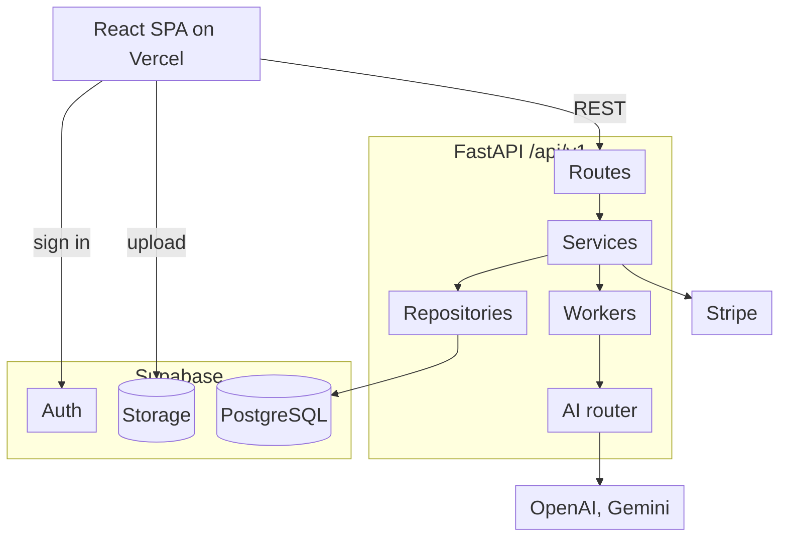
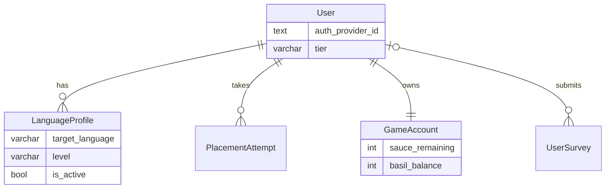
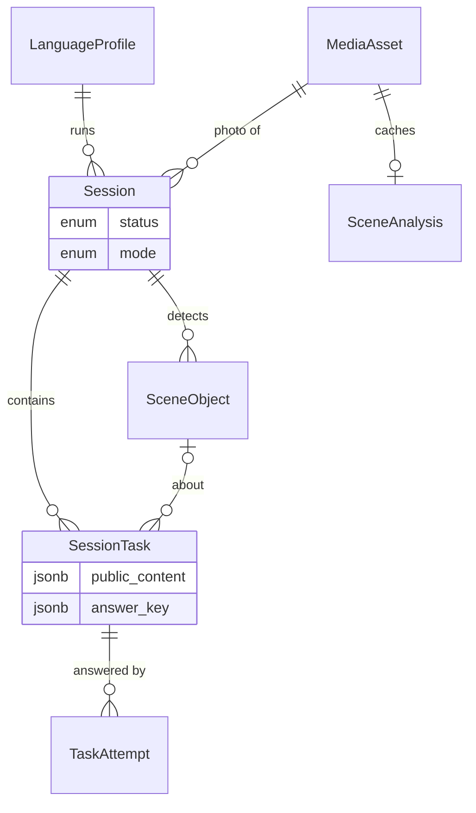
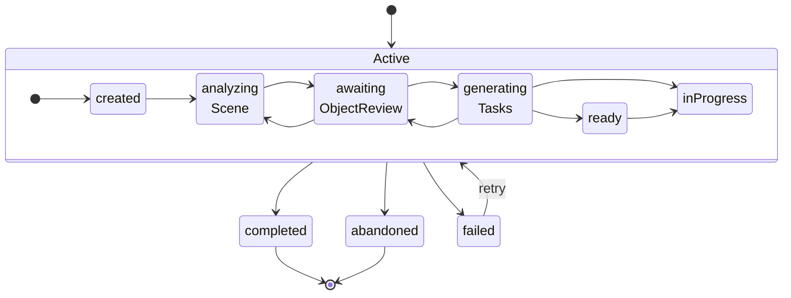
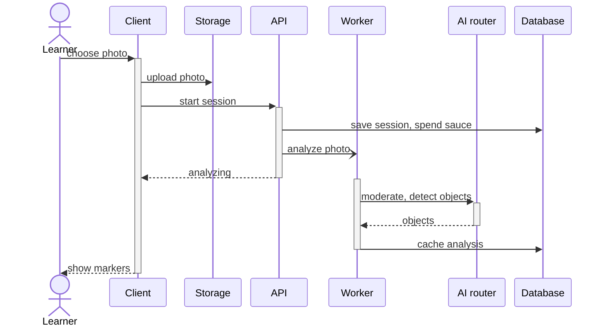
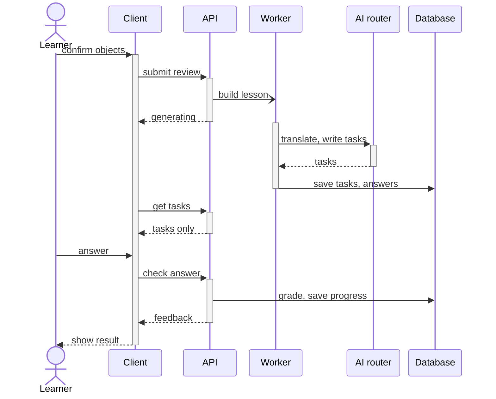
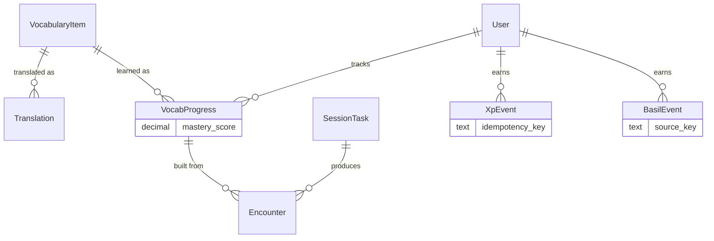
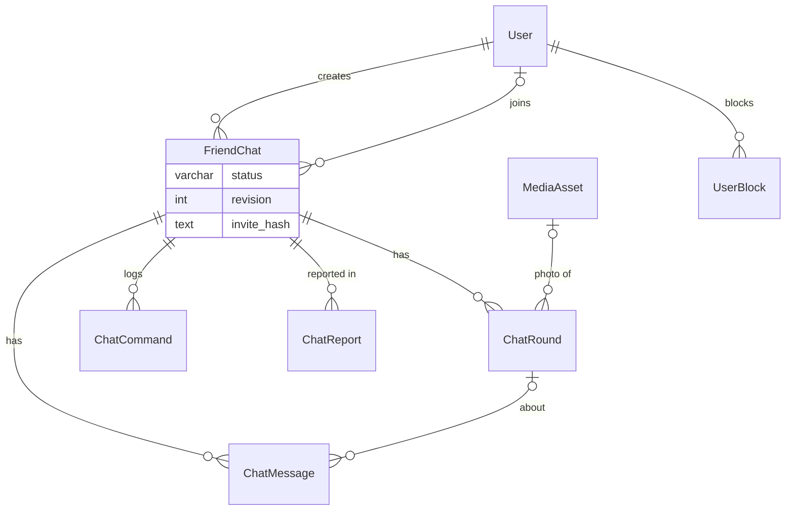
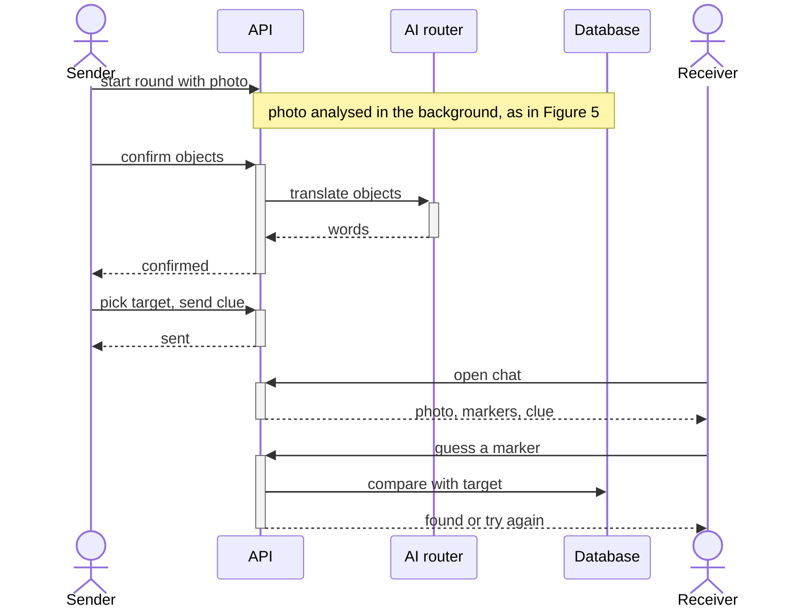

# Application Design

> Draft for the final report. Diagrams are written in Mermaid. Render them at
> [mermaid.live](https://mermaid.live), export as SVG or PNG, and paste them into the
> Word document. Keep the `%%{init…}%%` line at the top of each diagram when pasting,
> because it sets the font size and spacing.
>
> The design is split by feature area, so each diagram covers only one part of the
> app. Sizes in Word (A4, 2.5 cm margins) that give about 9 pt text:
>
> | Fig | Width × height | Fig | Width × height |
> | --- | --- | --- | --- |
> | 1 | 12 × 8 cm | 6 | 14 × 14 cm |
> | 2 | 15 × 4.5 cm | 7 | 16 × 5 cm (8 pt) |
> | 3 | 7.5 × 11 cm | 8 | 15 × 8.5 cm |
> | 4 | 16 × 6 cm (8 pt) | 9 | 14 × 13 cm |
> | 5 | 16 × 10 cm | | |
>
> Figure 3 is narrow enough to sit beside its bullet points. With every figure
> included the section runs to about 5 pages. To save space, drop Figures 2 and 7
> first; their text stands on its own.

## 1. System architecture

Linguini is split into a single-page web client and a separate API service. Supabase
provides identity, the PostgreSQL database and private photo storage. All learning
logic, grading and rewards live on the server. The client only renders state the
API returns.

*Figure 1. Deployment and component view. Not drawn: Langfuse tracing on the AI
router, GA4 and Contentsquare analytics in the browser, and Prisma owning the
database schema.*

- **Three backend layers.** Routes handle HTTP and authentication, services hold the
  business rules, and repositories run SQL. Prisma owns the schema and migrations,
  while the Python code queries through SQLAlchemy Core. This keeps schema changes
  reviewable without tying runtime code to an ORM.
- **Photos never pass through the API.** The client asks the API for a signed upload
  URL, uploads directly to private Supabase Storage, and then confirms the upload.
  The API records it as a `MediaAsset`. The bucket stays private: the API serves each
  photo back itself, resized to 320, 640 or 1280 px WebP with cache headers, so a
  photo URL can't be shared outside the app.
- **Slow AI work runs off the request path.** Scene analysis and lesson generation run
  on a background worker pool. The client polls until the work finishes, so a 30–60
  second model call never holds an HTTP request open.
- **AI routing is configuration, not code.** Each AI feature (scene analysis,
  translation, lesson tasks, I-Spy clues, I-Spy guesses) is a named route in
  `ai.toml` that points to a model, a time budget and a call limit. Each provider has
  several API keys, which the router rotates through to spread rate limits.
  Swapping a model after an evaluation run needs only a config change. AI calls are
  traced in Langfuse to monitor cost and latency.
- **Model choice was driven by evaluation.** We picked a model per task by running
  labelled evaluation sets. GPT-4.1-mini reads photos and judges I-Spy guesses,
  GPT-5.4-mini translates scenes and writes lessons, and the cheaper, faster Gemini
  Flash Lite writes I-Spy clues. OpenAI's Moderation API screens every uploaded photo.

## 2. Feature areas

The database has 51 tables. Rather than one large diagram, each feature area below
gets its own small one, showing only the tables that area uses.

| Area | What the learner does | Section |
| --- | --- | --- |
| Account and onboarding | Signs in, picks a language, takes a placement quiz, upgrades | 3 |
| Practice | Turns a photo into a lesson and answers its tasks | 4 |
| Vocabulary and rewards | Reviews learned words, earns XP and Basil points | 5 |
| I-Spy | Plays solo, joins the daily challenge, plays with friends | 6 |

*Table 1. Feature areas covered in this section.*

## 3. Account and onboarding

*Figure 2. Account tables. PlacementAttempt = OnboardingPlacementAttempt.*

- **Sign-in is delegated.** Supabase handles passwords and tokens. Our `User` row
  stores only the Supabase identity (`auth_provider_id`), a display name and
  preferences, so no credentials live in our tables.
- **One account, several languages.** A learner can hold a `LanguageProfile` per
  target language, each with its own level, and switch between them. Only one is
  active at a time, and every lesson belongs to a profile, so progress in Spanish
  never mixes with progress in Korean.
- **Placement sets the starting level.** The onboarding quiz is graded on the server
  and stored as a `PlacementAttempt` together with the level it assigned.
- **Game state has one row per learner.** `GameAccount` holds the learner's "sauce"
  energy (spent to analyse a new photo, refilled over time) and Basil point balance.
  The `tier` field records whether the learner has upgraded through Stripe Checkout.

## 4. Practice: from photo to lesson

*Figure 3. Practice tables. SceneAnalysis = MediaSceneAnalysis.*

- **Answers never reach the client.** Each `SessionTask` stores what the learner sees
  (`public_content`) separately from the answer (`answer_key`). The API returns only
  the first. Answers are graded on the server against the stored key, with no AI call
  at grading time. This makes grading fast, free and repeatable, and stops learners
  from reading answers out of network traffic.
- **The database enforces ownership.** A session references its language profile
  together with the profile's user ID (a composite foreign key). A session therefore
  cannot point at another learner's profile, even if application code has a bug.
- **AI output is cached per photo.** `SceneAnalysis` stores the analysis of each
  photo, labelled with the prompt and schema version. Reusing a photo for I-Spy or a
  retry does not call the vision model again, and changing the prompt makes old
  results stale automatically.

### Session lifecycle

*Figure 4. UML state diagram for a practice session. `Active` groups the
non-final states; any of them can be abandoned or fail. Only `inProgress` can
move to `completed`. A retry resumes at whichever step failed.*

The status is enforced in the repository layer: only the transitions shown are
allowed, and each change is a compare-and-set update. If two requests race (for
example, a double tap), one fails cleanly instead of corrupting the session.

- **`awaitingObjectReview` keeps a human in the loop.** The vision model can mislabel
  objects. Before any lesson is generated, the learner sees numbered markers on the
  photo and can remove, add or rename objects. This takes a few seconds and prevents
  a whole lesson being built on a wrong word.
- **`failed` is recoverable.** Each failure is stored with a specific code (for
  example `imageModerationFailed`, `noValidObjects` or `taskGenerationFailed`), so the
  client can show a tailored message and offer a retry from the step that failed. The
  sauce spent on the analysis is refunded.

### Analysing the photo

*Figure 5. UML sequence diagram for photo analysis. Bars show when each part is
busy; half-arrows are asynchronous. The client polls the session until the worker
finishes. Moderation and object detection are separate model calls run in
parallel, so the safety check adds no wait. A photo analysed before skips the
worker and returns its cached result.*

### Building and answering the lesson

*Figure 6. UML sequence diagram for lesson generation and grading. "Translate,
write tasks" is two model calls: one translates the confirmed objects, the next
writes tasks from them. Grading ("check answer") only compares against the stored
answer key.*

## 5. Vocabulary and rewards

*Figure 7. Vocabulary and reward tables. Translation = VocabularyTranslation,
VocabProgress = UserVocabularyProgress, Encounter = VocabularyEncounter,
BasilEvent = GameResourceEvent.*

- **Words are shared; progress is personal.** A `VocabularyItem` is stored once and
  shared by every learner who meets it. Each learner's knowledge of that word lives
  in their own `VocabProgress` row.
- **Progress is built from evidence.** Every graded answer writes an `Encounter`
  row, which updates the learner's `mastery_score` for that word. The vocabulary page
  and review prompts read from this history rather than from a single counter, so
  mastery can be explained and recomputed.
- **Retries cannot double-count.** XP and Basil events each carry a unique key built
  from what earned them (for example `session:<id>` for finishing a lesson). A retry
  after a dropped connection cannot award points twice.

## 6. I-Spy

I-Spy has three modes, all built on the practice pipeline:

- **Solo I-Spy** creates a new session in `ispy` mode as a copy of a lesson's
  confirmed scene, so no photo is analysed twice. Gemini Flash Lite writes the clues.
  When the learner describes an object, GPT-4.1-mini decides which object the
  description points to without being told the target, so the model cannot be
  biased toward marking the learner correct.
- **Daily challenge** gives everyone the same scene each day. Each learner's found
  words are recorded once, and after the day ends learners are ranked by how rarely
  others found the same words, with a Basil bonus. **Chef of the Day** is an opt-in
  leaderboard of Basil earned that day; learners who have not opted in never appear,
  and it shows only a profile name, score and rank.
- **Friend I-Spy** is a private, turn-based chat between two learners, shown below.

*Figure 8. Friend I-Spy tables. ChatRound, ChatMessage, ChatCommand and ChatReport
are FriendChatRound, FriendChatMessage, FriendChatCommand and FriendChatReport.*

*Figure 9. UML sequence diagram for one Friend I-Spy round. After a wrong guess the
sender can add a clue or reveal the answer; the guesser starts the next round.*

- **The answer is hidden until the round ends.** Every detected object is marked,
  with the target among them, and each marker carries an opaque key in the same
  shape. Unfinished rounds never send object names, the answer or the target's
  position to the receiver. The server checks a guess by comparing keys.
- **Every action is safe to repeat.** Each command (confirm objects, send clue,
  guess) is logged in `ChatCommand` with a client-generated ID, so a retried request
  returns the first result instead of acting twice. The chat's `revision` number
  rejects actions based on an out-of-date view, for example when both players act at
  once.
- **Privacy and safety.** A chat is joined only through a private invitation that
  expires and can be revoked. Either learner can leave, block or report the chat.

## 7. Client design (optional, if page budget allows)

A one-row strip of 4–5 screenshots from `docs/screenshots/` showing onboarding →
home → photo review → lesson task → I-Spy works well here. Two sentences cover the
client architecture: React Router for navigation, TanStack Query for server state
and polling, and a shared design-token system (`frontend/design.md`) for the visual
language. Every user action is instrumented through one `trackAction` helper that
logs to both GA4 and Contentsquare. That helper is the source of the User Statistics
section.
